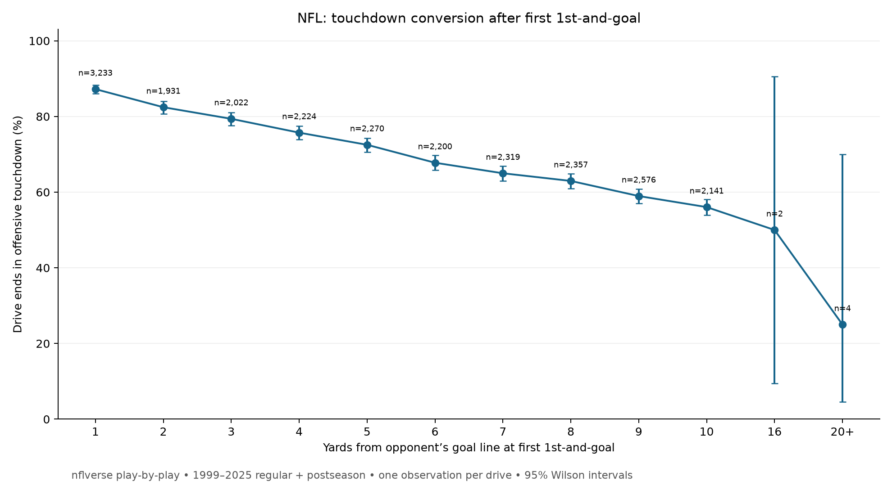

# First 1st-and-goal touchdown rate

When an NFL drive reaches **1st-and-goal**, how often does that drive end in an offensive touchdown, and how does that rate change with the yard line of the *first* 1st-and-goal?

Using open-source [nflverse play-by-play](https://github.com/nflverse/nflverse-data/releases/tag/pbp) for the 1999–2025 seasons (regular season and playoffs), **16,550 of 23,279 drives** that reached 1st-and-goal ended in an offensive touchdown (**71.1%**). The rate falls steadily with distance: **87.2%** when the first 1st-and-goal is at the 1-yard line, and **56.0%** at the 10.



## Data

Season files `play_by_play_{year}.parquet` from the nflverse `pbp` release, seasons **1999 through 2025**. The 2026 season is not included. Rows are limited to `season_type` of `REG` and `POST`.

`analyze.py` downloads a season file into `data/` only when that file is not already there. `data/` is gitignored; the committed outputs are the drive-level results, not the raw parquet.

## Definitions

A drive is in the sample once. The yard line is the spot of that drive’s **first** 1st-and-goal. Any later 1st-and-goal on the same drive is ignored.

A play counts as 1st-and-goal when all of the following hold:

- `down == 1` and `goal_to_go == 1` (the line to gain is the goal line).
- `yardline_100` is present (yards from the opponent’s goal line).
- The play is a **run**, a **pass**, or a **penalty `no_play`** (`play_type == 'no_play'` and `penalty == 1`).
- `posteam` is present and the drive key is present.

Kneels, spikes, and timeouts never meet that play-type filter, so they cannot mark the first 1st-and-goal.

The drive key is `fixed_drive`, with `drive` used only when `fixed_drive` is missing. Plays are ordered by `game_id`, then `game_seconds_remaining` descending, then `play_id`, and the first qualifying play is kept for each `game_id` + drive key.

**Success** is `fixed_drive_result == 'Touchdown'`. That is the offensive touchdown result for the drive. A field goal, a turnover, the end of the half, or a defensive score is not a success. The yard line does not have to be the snap that scores: a drive that reaches 1st-and-goal and scores later on that same possession still counts.

## Results, 1999–2025

| Yard line | Drives | Touchdowns | TD % | 95% Wilson CI |
| --- | ---: | ---: | ---: | --- |
| 1 | 3,233 | 2,820 | 87.2 | 86.0–88.3 |
| 2 | 1,931 | 1,592 | 82.4 | 80.7–84.1 |
| 3 | 2,022 | 1,605 | 79.4 | 77.6–81.1 |
| 4 | 2,224 | 1,684 | 75.7 | 73.9–77.5 |
| 5 | 2,270 | 1,646 | 72.5 | 70.6–74.3 |
| 6 | 2,200 | 1,491 | 67.8 | 65.8–69.7 |
| 7 | 2,319 | 1,507 | 65.0 | 63.0–66.9 |
| 8 | 2,357 | 1,484 | 63.0 | 61.0–64.9 |
| 9 | 2,576 | 1,519 | 59.0 | 57.1–60.9 |
| 10 | 2,141 | 1,200 | 56.0 | 53.9–58.1 |
| 16 | 2 | 1 | 50.0 | 9.5–90.5 |
| 20+ | 4 | 1 | 25.0 | 4.6–69.9 |
| **All** | **23,279** | **16,550** | **71.1** | |

Percentages in the table are rounded to one decimal. `td_by_starting_yard.csv` has the unrounded rates and interval endpoints. `first_goal_drives.csv` is one row per drive. Yard lines from 11–15 and 17–19 do not appear because no drive in this sample had its first 1st-and-goal there. The `20+` row is the four drives at the 20, 23, 24, and 25.

## 2015–2025

The same definition on seasons 2015–2025 is **7,421 touchdowns / 10,069 drives = 73.7%**. The by-yard-line breakdown, including Wilson intervals, is in `td_by_starting_yard_2015_2025.csv`. Inside the 1-to-10 range the recent window sits a few points above the full 1999–2025 rates (89.4% at the 1, 59.7% at the 10). The only drives beyond the 10 in this window are one at the 23 and one at the 25.

## Caveats

- **Six drives start 16 or more yards from the goal line**: two at the 16, and one each at the 20, 23, 24, and 25. Those rates are tiny samples. The Wilson intervals on the chart show that: the 16-yard point is 9.5–90.5%, and the 20+ point is 4.6–69.9%. The intervals are too wide to extend the 1-to-10 trend.
- **One known nflverse labeling error** is in `scoring_audit.csv`: `2011_13_DET_NO`, play 1655. The description is Kevin Smith’s 2-yard touchdown for Detroit, and the play is flagged as an offensive touchdown, but `fixed_drive_result` is `Field goal`. Under the success rule this drive is **not** counted as a touchdown. It is the only row where `fixed_drive_result == 'Touchdown'` disagrees with a direct offensive-touchdown flag (touchdown credited to `posteam`, not a `no_play`, and not a return touchdown).
- Success is the **drive result**, so a penalty, sack, or incomplete pass on the first 1st-and-goal snap can still be a success if the offense scores later in the drive. A touchdown on a nullified `no_play` does not, by itself, make `fixed_drive_result` a touchdown.
- `fixed_drive` repairs some possession-labeling mistakes in nflverse. Where it is missing, the script falls back to `drive`.

## How to run

From this folder, with Python 3:

```bash
python -m venv .venv
source .venv/bin/activate
pip install -r requirements.txt
python analyze.py
```

The first run downloads one parquet per season into `data/` (gitignored). Later runs reuse those files. The script rewrites:

- `first_goal_drives.csv` — one row per qualifying drive
- `scoring_audit.csv` — drives where the touchdown result and the offensive-touchdown flag disagree
- `td_by_starting_yard.csv` — 1999–2025 rates and 95% Wilson intervals
- `td_by_starting_yard_2015_2025.csv` — the same table for 2015–2025
- `td_success.png` — TD% by starting yard line with 95% Wilson intervals
- `summary.json` — overall counts

Paths are relative to the script file, so the working directory does not matter as long as `python /path/to/1st-and-goal/analyze.py` can see the network on a cold cache.
